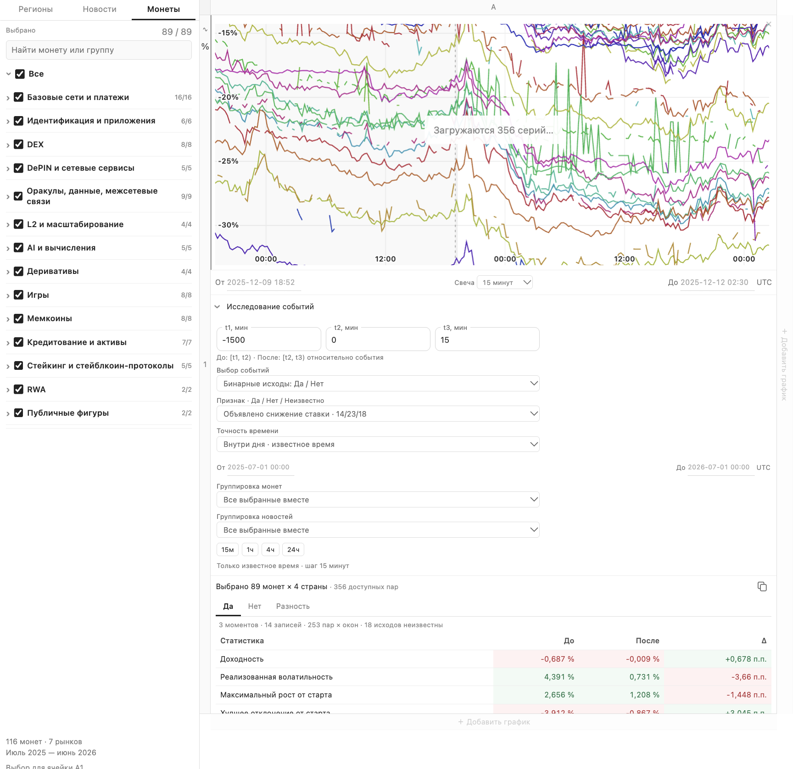

# region-market

**Crypto Workspace** — интерактивный визуализатор региональных криптовалютных рынков и реакции цен на новости. Он позволяет выбирать монеты и регионы, сравнивать графики с шагом от 15 минут и исследовать доходность, волатильность и объём до и после событий в настраиваемых временных окнах.

[Код, тесты и инструкция запуска](src/). Датасеты котировок и новостей не включены.

Исследовательский набор охватывал июль 2025 — июнь 2026: 116 монет из 14 тематических групп, 7 региональных рынков (США, еврозона, Индонезия, Таиланд, Южная Корея, Гонконг, ОАЭ) и 4 634 новостные записи; в новостях также представлен Китай. [Краткая характеристика состава данных](src/#какие-данные-использовались).
