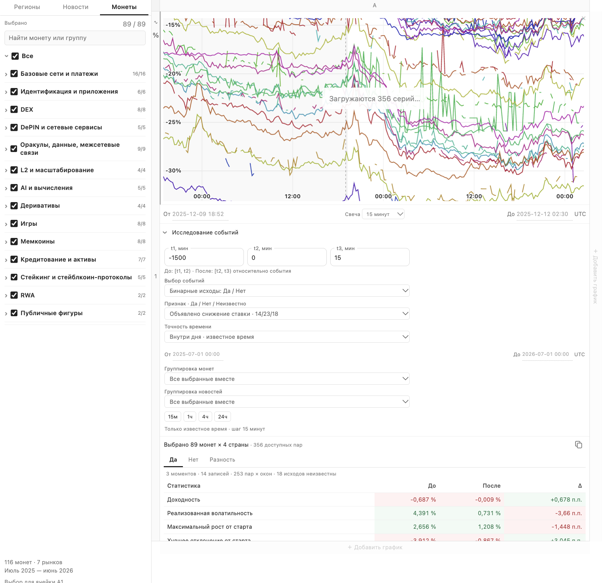

# Ядро визуализатора

**Crypto Workspace** — интерактивный визуализатор региональных криптовалютных рынков и реакции цен на новости. Он позволяет выбирать монеты и регионы, сравнивать графики с шагом от 15 минут и исследовать доходность, волатильность и объём до и после событий в настраиваемых временных окнах.



Код интерактивного Crypto Workspace находится в [`vizualizer/explorer/`](vizualizer/explorer/).

- Интерфейс: сетка графиков, выбор регионов и групп монет, масштабирование и перемещение, 15-минутные свечи.
- Новости: отметки событий и исследование реакции, бинарные исходы, связанные цепочки, окна t1/t2/t3, группировка и копирование отчёта.
- Сервер: Python 3 и стандартная библиотека. Клиент: JavaScript, HTML, CSS и Canvas, без сборки и внешних библиотек.

**Датасеты котировок и новостей не публикуются.** Также отсутствуют исходные ответы API, кэши цен и прежняя статическая сборка со встроенными котировками. В репозитории только код, тесты и документация.

## Запуск с локальными данными

Сервер ожидает соседний каталог `diploma/regional_crypto_15m/` из исходного исследовательского проекта. Можно подключить существующий каталог символьной ссылкой; файлы данных при этом остаются вне репозитория:

```bash
# Из корня клонированного region-market:
ln -s /absolute/path/to/regional_crypto_15m diploma/regional_crypto_15m
cd diploma
python3 vizualizer/explorer/server.py
```

Открыть <http://127.0.0.1:8765>. Другой порт: `--port 8766`.

Внешние данные нужны для работы сервера: `news_ab_2025_07_2026_06/price_series.json`, определения наборов `semester_universe.json` и `us_kr_universe.json`, исторические CSV по путям из `price_series.json`, новостные календари и семантическая разметка. Их содержимое в эту публикацию не включено. Подробная документация интерфейса и методов расчёта: [`README.txt`](vizualizer/explorer/README.txt).

## Проверки без датасетов

Для клиентских проверок нужен Node.js, для серверных — Python 3:

```bash
cd diploma
node vizualizer/explorer/test_date_input.cjs
node vizualizer/explorer/test_study.cjs
node vizualizer/explorer/test_selection.cjs
node vizualizer/explorer/test_plot.cjs
python3 -m unittest discover -s vizualizer/explorer -p 'test_event_study.py'
```

Проверки сохранённых исследовательских данных пропускаются, если внешний каталог отсутствует. Остальные проверки работают автономно.
